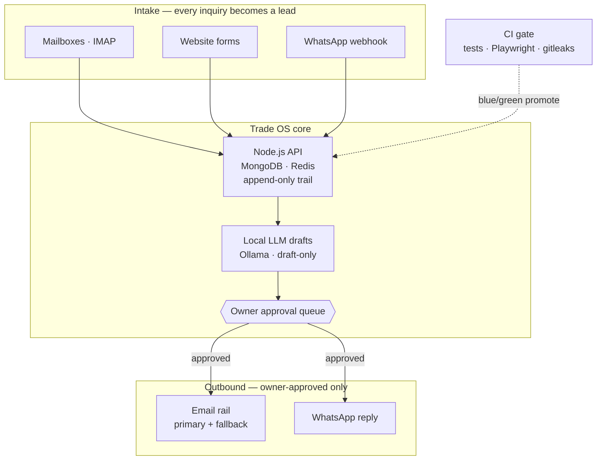
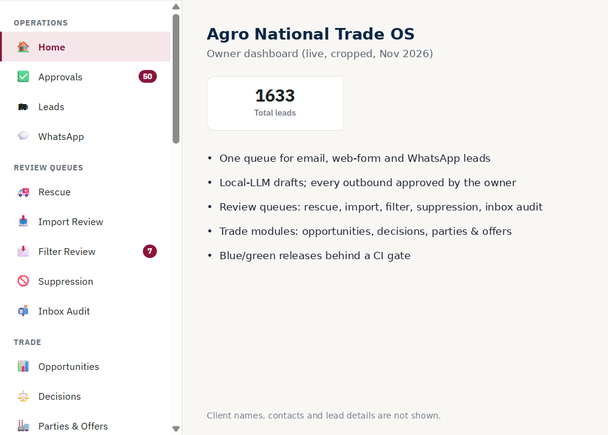
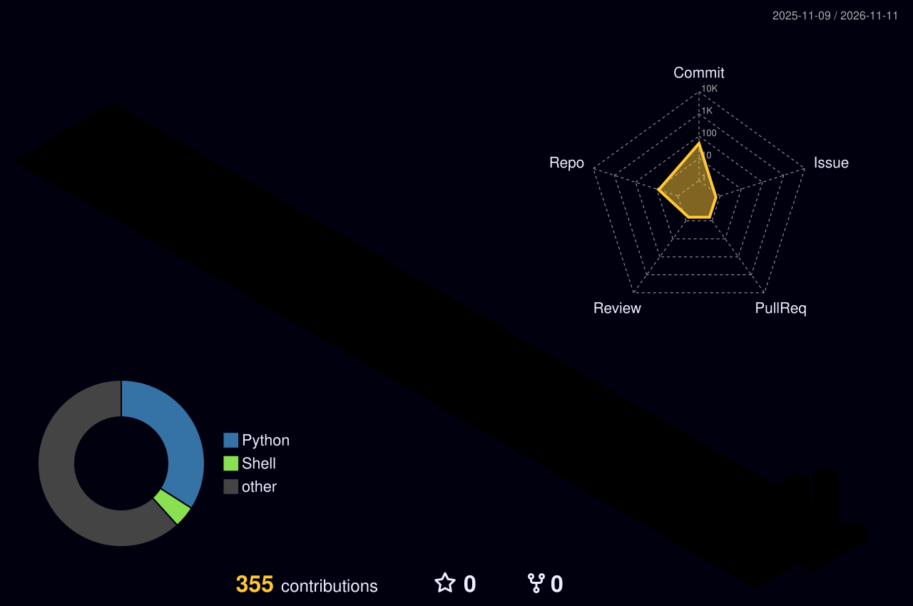

<div align="center">

# Noor Siddiqui

<a href="https://al-izn.com"></a>

[](https://www.linkedin.com/in/nooruddinsiddiqui)
[](https://medium.com/@N_Siddiqui555)
[](https://linktr.ee/noorsiddiqui)
[](https://x.com/N_Siddiqui555)
[](https://linktr.ee/noorsiddiqui)
[](mailto:hello@al-izn.com)
[](https://wa.me/971507264928)

</div>

> **AI innovation leader where technology, legal frameworks and funding meet.** I build and run self-hosted AI systems in production, set up the companies, compliance and governance around them, and structure the funding that keeps them going — 16+ years across B2B trade, tax and corporate law, and digital infrastructure.

I lead applied-AI work end to end: architecture and live operations on infrastructure I control, the legal and regulatory frame (company formation, compliance, data governance), and the funding model (grants, CSR, government schemes and investor readiness). Nothing leaves the gate without an authenticated person approving it, and nothing is called done until it is proven on the live system.

### At a Glance
- **1,500+ leads** handled in a CRM I designed and operate (CRM data, Nov 2026)
- **10+ countries** of trade reach · **500+ verified companies** on the platform (Agro National records, Nov 2026)
- **Zero paid AI APIs** — local models (Ollama) on my own servers
- **16+ years** across company formation, tax compliance, digital marketing and B2B trade
- **10 years** structuring CSR, FCRA and government-scheme funding, project reports and DPRs for companies and NGOs

### Leadership — Building Ventures, Funding and Institutions
- **Funding & grants:** ten years structuring CSR funding, FCRA-registered funding, government-scheme registrations, project reports and DPRs for companies and NGOs.
- **Legal & institutional setup:** company formation, NGO and trust registration, tax and regulatory compliance across India and the UAE, and day-to-day government liaison.
- **Venture building:** founded IZN AI; run Agro National's trade desk end to end — from intake and compliance to documentation and deal flow.
- **AI capability inside organisations:** design the operating model, not just the code — written governance (a "constitution"), human-approval gates, acceptance tests on live systems, and an AI engineering team that ships through reviewed pull requests.

### R&D Roadmap
| Phase | Focus | Status |
|---|---|---|
| **1 · Foundation** | Multi-channel intake, append-only lead trail, owner-approved outbound, blue/green releases with CI gates | ✅ In production |
| **2 · Agentic operations** | Draft-only AI employees (intake, follow-up, compliance, reporting) on local models, every action human-approved | 🔄 Building |
| **3 · Trade engine** | Seller mandates, inventory, buyer–seller matching, Quote & Lock, document desk on letterhead | 🔄 Building |
| **4 · Enterprise & regional adoption** | White-label Trade OS for other B2B firms; self-hosted AI adoption for SMEs, manufacturing and regional trade ecosystems | 🧭 Vision |
| **5 · AI innovation & incubation** | Applied-AI R&D lab, automation and robotics pilots, startup incubation and industry–academia partnerships, funded through grants, CSR and investors | 🧭 Vision |

### Selected Work — Agro National Trade OS (private, in production)
The operating system behind a Dubai fertilizer and agri-chemical trading desk.
- **Problem:** inquiries arrived across several mailboxes, web forms and WhatsApp; leads were lost, replies were slow and nothing was auditable.
- **Architecture:** IMAP + web-form + WhatsApp webhook intake → Node.js/MongoDB CRM with an append-only trail per lead → local-model draft engine → owner approval queue → Brevo email rail (cPanel fallback) and WhatsApp.
- **Invariants enforced in code and tests:** every inquiry becomes a lead or a quarantine record (no silent drops) · only the owner can approve or send · send window and daily caps enforced server-side · compliance flags inform, they never block · one runtime, promoted only by hand.
- **Delivery:** blue/green on Nginx with rollback under 5 seconds, CI on a self-hosted runner (tests, Playwright smoke, gitleaks, semgrep), an AI engineering team working through PRs and a written constitution, with acceptance tests on LIVE as the definition of done.



<p align="center"></p>


### Open Source Projects
- **[devops-case-studies](https://github.com/NoorSiddiquiDubai/devops-case-studies)** — five sanitized production case studies (Problem → Action → Evidence → Result): self-hosted CI + Playwright gate, blue/green auto-failover, RAID 6 rescue-mode recovery, cPanel → AWS EC2 cutover, secret-scanning sweep. CI-checked.
- **[izn-ai](https://github.com/NoorSiddiquiDubai/izn-ai)** — product overview of IZN AI, the private AI search and mediation platform I am building for the UAE & GCC (product code private).
- **[multimodal-compliance-auditor](https://github.com/NoorSiddiquiDubai/multimodal-compliance-auditor)** — packaging & label compliance auditor for US FDA 21 CFR and UAE MoIAT (FastAPI + Vision + Docker, with tests).
- **[sovereign-ai-agent-engine](https://github.com/NoorSiddiquiDubai/sovereign-ai-agent-engine)** — multi-agent intake engine with deterministic human-in-the-loop release gates, SHA-256 audit hashing and local Ollama orchestration.
- **[ai-agent-working-contract](https://github.com/NoorSiddiquiDubai/ai-agent-working-contract)** — the governance contract and review routine I give every AI coding agent ("No evidence, no done").
- **[projects](https://github.com/NoorSiddiquiDubai/projects)** — live websites and products I have built and run, with screenshots.

### Published Technical Articles
<!-- BLOG-POST-LIST:START -->
- [Deterministic Multimodal Vision Auditing for FDA & UAE Regulatory Compliance: Why LLM Probabilities…](https://medium.com/@N_Siddiqui555/deterministic-multimodal-vision-auditing-for-fda-uae-regulatory-compliance-why-llm-probabilities-c04719dc3739?source=rss-d70a114bf344------2)
- [Building Sovereign AI Architectures in Dubai: Why Enterprise AI Needs Deterministic Governance](https://medium.com/@N_Siddiqui555/building-sovereign-ai-architectures-in-dubai-why-enterprise-ai-needs-deterministic-governance-d63b8450ec9f?source=rss-d70a114bf344------2)
<!-- BLOG-POST-LIST:END -->

<details>
<summary><b>Career background</b></summary>

- **Founder, IZN AI** ([al-izn.com](https://al-izn.com)) — private AI search, verified professional directory and AI-assisted mediation for the UAE and GCC (2025–Present)
- **Director, Agro National Chemical & Fertilizer Trading Co. LLC** ([agronational.ae](https://agronational.ae)), Dubai — GCC & Africa agri-fertilizer trade and B2B CRM automation (2023–Present)
- **Director, Aramco India** ([aramcoindia.com](https://aramcoindia.com)), Dubai — IT, SEO and digital marketing: setting up and promoting companies online (2010–Present)
- **Executive Director, Delhi branch, Roshan Accountax Pvt. Ltd.** ([roshantax.com](https://roshantax.com)) — company formation, taxation, government liaison, NGO / FCRA / CSR and project reports (2010–2020)
- **Author, eTaxDial** ([etaxdial.com](https://etaxdial.com)) — authority blog on taxation, legal and company setup across India, the UAE and international markets (2013–Present)

</details>

<details>
<summary><b>DevOps & reliability — what I run in production</b></summary>

- **CI/CD:** GitHub Actions on a self-hosted runner under a dedicated non-root user; every pull request runs syntax checks, unit fixtures and a Playwright end-to-end suite against staging before it can merge.
- **Zero-downtime releases:** blue/green behind Nginx, owner-only promote, health checks and rollback under 5 seconds.
- **Secret hygiene:** gitleaks on every push, credential files kept out of Git, leaked keys revoked rather than just deleted.
- **Incident response:** recovered a locked-out bare-metal server through rescue mode — assembled the RAID6 array, traced the root cause from sshd logs and restored every service on a clean reboot.
- **Cloud migration:** moved a SaaS dashboard from shared hosting to AWS EC2 behind Caddy, with an Elastic IP, low-TTL DNS cutover and a fallback path during propagation.
- **Hardening:** key-only SSH, fail2ban, least-privilege service users, systemd-managed services, encrypted off-site backups taken before every change.

</details>

<details>
<summary><b>What I build</b></summary>

- **Trade & B2B CRM:** unified intake across email, web forms and WhatsApp; deduplication; SLA tracking; approval queues; compliance verification.
- **Regulatory compliance engines:** deterministic artwork and label validation for US FDA (21 CFR Part 101) and UAE MoIAT (GSO 9:2013).
- **Agent workflows:** multi-agent intake pipelines with human-in-the-loop approvals on self-hosted models (Ollama / vLLM).

</details>

<details>
<summary><b>Technology radar</b></summary>

| Ring | What I use or study |
|---|---|
| **Adopt** | Self-hosted LLMs (Ollama) · Docker · blue/green on Nginx · self-hosted CI runners · Playwright gates · gitleaks · MongoDB |
| **Trial** | Draft-only multi-agent "AI employees" · official WhatsApp Cloud API (coexistence) · encrypted off-site backups with restore tests |
| **Assess** | vLLM for higher-throughput inference · self-hosted sanctions screening · deterministic rule engines alongside LLMs |
| **Hold** | Sending client data to paid third-party AI APIs · unofficial WhatsApp bridges · deploys without a tested rollback |

</details>

<details>
<summary><b>Live systems</b></summary>

| Platform | Overview |
|---|---|
| [al-izn.com](https://al-izn.com) | IZN AI — private AI search, verified professional directory and mediation platform for the UAE & GCC |
| [agronational.ae](https://agronational.ae) | Agro National — B2B fertilizer and agri-chemical trading across the Middle East and Africa |
| [etaxdial.com](https://etaxdial.com) | eTaxDial — corporate, tax and legal compliance guides for India, the UAE and the US |
| [roshantax.com](https://roshantax.com) | Legal, tax and corporate compliance services |
| [aramcoindia.com](https://aramcoindia.com) | Aramco India — company setup, IT, SEO and digital marketing services |
| [vsjksb.world](https://vsjksb.world) | Community development, vocational training and welfare initiative portal |

</details>

### Technical Stack
<p>
  
  <br/>
  
</p>


### GitHub Activity
<p align="center">
  
</p>
<p align="center">
  
</p>

### Quick Intro from the Terminal
```bash
curl -s https://raw.githubusercontent.com/NoorSiddiquiDubai/NoorSiddiquiDubai/main/intro.json | jq
```

### Work With Me
I take on a small number of fixed-scope engagements:
- **DevOps hardening & rescue** — server lockouts, SSH/firewall hardening, backups with tested restores, monitoring
- **CI/CD & zero-downtime releases** — self-hosted runners, test gates, blue/green deploys with one-step rollback
- **Self-hosted AI** — local LLMs (Ollama) with human-in-the-loop approvals, no data sent to third-party AI APIs
- **B2B CRM & intake automation** — email, web-form and WhatsApp intake into one approval-driven CRM

Every engagement ships with a written scope, evidence for each item delivered, and a handover — the same [working contract](https://github.com/NoorSiddiquiDubai/ai-agent-working-contract) I hold my own systems to.
- **Central Directory:** [linktr.ee/noorsiddiqui](https://linktr.ee/noorsiddiqui)
- **Direct WhatsApp:** [+971 50 726 4928](https://wa.me/971507264928)
- **Email:** [hello@al-izn.com](mailto:hello@al-izn.com)
- **Fixed-Price Packages:** [linktr.ee/noorsiddiqui](https://linktr.ee/noorsiddiqui)
